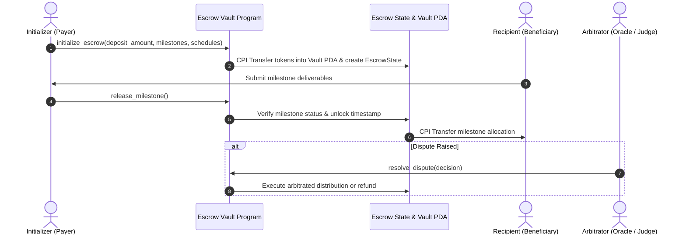

# Solana Anchor Escrow Vault

[](https://solana.com)
[](https://coral-xyz.github.io/anchor/)
[](https://spl.solana.com)
[](https://opensource.org/licenses/Apache-2.0)

A non-custodial milestone escrow and conditional token streaming program on Solana written with the **Anchor Framework**. Enables milestone-governed payments, multi-party dispute arbitration, and secure token custody via Program Derived Addresses (PDAs).

---

## 🌟 Key Features

- **Milestone-Based Releases**: Divide project compensation into discrete milestones with per-stage unlock timestamps and verification rules.
- **Non-Custodial PDA Escrow**: Funds are locked strictly inside deterministic PDAs signed by the program seeds `["vault", escrow_state.key()]`.
- **Arbitration & Dispute Resolution**: Configurable designated third-party arbitrator with dual authority to resolve disputes or trigger refunds.
- **SPL Token & Token-2022 Ready**: Full compatibility with both classic SPL Token standard and Token-2022 extensions.
- **Emergency Refund Mechanism**: Initializers can cancel and withdraw unvested funds before milestones lock, or upon mutually agreed terms.

---

## 🏗️ Program Architecture



---

## 📂 Project Structure

```text
solana-anchor-escrow-vault/
├── Anchor.toml                     # Anchor workspace configuration
├── Cargo.toml                      # Root Rust workspace definition
├── package.json                    # TypeScript dependencies & scripts
├── tsconfig.json                   # TypeScript compiler options
├── programs/
│   └── escrow-vault/
│       ├── Cargo.toml              # Rust crate dependencies
│       └── src/
│           └── lib.rs              # Anchor escrow program instructions & accounts
└── tests/
    └── escrow-vault.ts             # Mocha/Chai integration test suite
```

---

## 🚀 Getting Started

### Prerequisites

- [Rust](https://www.rust-lang.org/tools/install) `1.75.0` or higher
- [Solana CLI](https://docs.solanalabs.com/cli/install) `1.18.0` or higher
- [Anchor CLI](https://www.anchor-lang.com/docs/installation) `0.30.1`
- [Node.js](https://nodejs.org) `18+` and `yarn` / `pnpm`

### Installation

```bash
git clone https://github.com/orderlyozone/solana-anchor-escrow-vault.git
cd solana-anchor-escrow-vault
yarn install
```

### Build & Test

```bash
# Compile Anchor Rust smart contract
anchor build

# Execute TypeScript end-to-end tests
anchor test
```

---

## 📜 Instructions

### 1. `initialize_escrow`
Locks tokens from the initializer into a program-owned vault PDA, specifying recipient, arbitrator, total milestones, and vesting timestamps.

### 2. `release_milestone`
Transfers the proportional share of locked tokens for the current milestone to the recipient upon verification.

### 3. `cancel_and_refund`
Allows the initializer or arbitrator to refund remaining unreleased funds back to the initializer in case of cancellation or breached terms.

---

## 🛡️ Security & Audits

- Zero `unwrap()` calls on unchecked user input.
- Strict constraint checks (`seeds`, `bump`, `has_one`) on all sensitive PDA accounts.
- CPI transfers executed with explicit seeds verification against re-entrancy.

---

## 📄 License

Licensed under the [Apache License, Version 2.0](LICENSE).
